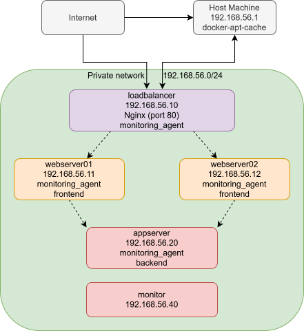

# Sherlock Logs

A containerized infrastructure with centralized monitoring and logging, fully automated with Vagrant and Ansible. A diagnostic frontend displays live system metrics served by a backend API, distributed across two web servers behind a load balancer. A GitHub Actions CI/CD pipeline automatically tests, builds, and publishes updated images, which are picked up and deployed by Watchtower. A dedicated monitoring VM runs Prometheus, Grafana, and the ELK stack to provide real-time visibility across all infrastructure components.

---

## Architecture



| VM           | IP            | Role                                              |
|--------------|---------------|---------------------------------------------------|
| loadbalancer | 192.168.56.10 | Nginx reverse proxy, distributes traffic          |
| webserver01  | 192.168.56.11 | Frontend container, serves UI and proxies metrics |
| webserver02  | 192.168.56.12 | Frontend container, serves UI and proxies metrics |
| appserver    | 192.168.56.20 | Backend container, exposes metrics API            |
| monitor      | 192.168.56.40 | Prometheus, Grafana, ELK stack                    |

---

## Objectives

- Fully automate infrastructure provisioning with Vagrant and Ansible
- Deploy a containerized application across a multi-server infrastructure
- Configure a load balancer to distribute traffic between two web servers
- Implement a CI/CD pipeline that detects code changes, builds images, and deploys updates automatically
- Centralize monitoring with Prometheus and Grafana
- Centralize logging with the ELK stack
- Alert on critical infrastructure events via Discord

---

## System Requirements

- At least 16GB RAM
- At least 50GB free disk space

## Prerequisites

- [Vagrant](https://www.vagrantup.com/)
- [VirtualBox](https://www.virtualbox.org/)
- [Ansible](https://www.ansible.com/)

Install required Ansible collections:

```bash
ansible-galaxy collection install community.docker community.general ansible.posix
```

Generate the required SSH key:

```bash
ssh-keygen -t ed25519 -f ~/.ssh/devops_key -N ""
```

Copy `.env.example` to `.env` and fill in the required values:

```bash
cp .env.example .env
```

---

## Configuration

`.env` reference:

| Variable               | Required | Description                                            |
|------------------------|----------|--------------------------------------------------------|
| `DEVOPS_PASSWORD`      | Yes      | Password for the devops user on all VMs                |
| `GRAFANA_PASSWORD`     | Yes      | Password for the Grafana admin user                    |
| `DISCORD_WEBHOOK_URL`  | Yes      | Discord webhook URL for alert notifications            |
| `APT_CACHE_URL`        | No       | URL of an apt-cacher-ng proxy to speed up provisioning |

### Apt Cache (Optional)

An apt-cacher-ng proxy caches packages on the first download and serves them locally for all subsequent requests, significantly speeding up provisioning when rebuilding VMs frequently. If not set, provisioning works normally without the cache.

```bash
docker run -d \
    --name apt-cache \
    --restart unless-stopped \
    -p 3142:3142 \
    -v apt-cache-data:/var/cache/apt-cacher-ng \
    sameersbn/apt-cacher-ng
```

Then set in `.env`:

```
APT_CACHE_URL=http://192.168.56.1:3142
```

---

## Setup and Installation

```bash
vagrant up
```

Vagrant will spin up all five VMs and run Ansible to provision them. The full setup takes around 15-20 minutes on first run due to Docker image downloads.

To reprovision without recreating VMs:

```bash
vagrant provision
```

To destroy all VMs:

```bash
vagrant destroy -f
```

---

## Accessing the Application

| Service       | URL                          |
|---------------|------------------------------|
| Application   | http://192.168.56.10         |
| Prometheus    | http://192.168.56.40:9090    |
| Grafana       | http://192.168.56.40:3000    |
| Kibana        | http://192.168.56.40:5601    |
| Alertmanager  | http://192.168.56.40:9093    |

The load balancer distributes requests between webserver01 and webserver02. Refreshing the page alternates the responding web server hostname, confirming load balancing is working.

---

## Quick SSH Access

A Windows Terminal helper script opens SSH sessions to all VMs in a single split-pane window:

```bat
.\terminal.cmd
```

To SSH into a single VM manually:

```bash
ssh -i ~/.ssh/devops_key devops@192.168.56.10
```

---

## Application

The monitoring application is maintained as a separate public repository: [simple-infra-monitor](https://github.com/DreXtrime/simple-infra-monitor)

Both components are published to GitHub Container Registry and kept up to date by Watchtower running on each host.

```
ghcr.io/drextrime/infra-backend:latest
ghcr.io/drextrime/infra-frontend:latest
```

---

## CI/CD Pipeline

The [monitoring application](https://github.com/DreXtrime/simple-infra-monitor) repository has a GitHub Actions workflow that triggers on every push and pull request:

- **Test** - runs pytest, flake8, and bandit security scans against both frontend and backend
- **Build** - builds Docker images for both components
- **Publish** - on pushes to main, publishes updated images to GitHub Container Registry tagged as `latest` and the commit SHA

Watchtower polls GitHub Container Registry every 30 seconds and automatically deploys new images with no manual intervention.

---

## Monitoring

Prometheus scrapes metrics from all infrastructure components every 15 seconds:

- **Node Exporter** - host level metrics (CPU, memory, disk, network) from each VM
- **cAdvisor** - per container metrics from each VM
- **Application** - custom metrics exposed by the backend via `prometheus_client`

Grafana dashboards are provisioned automatically and available at `http://192.168.56.40:3000`:

- VM Performance Dashboard
- Docker Container Dashboard
- Application Performance Dashboard

---

## Logging

Filebeat runs on each VM and ships logs to Logstash on the monitor VM. Logstash tags and forwards them to Elasticsearch, where they are visualized in Kibana at `http://192.168.56.40:5601`:

- System Logs Dashboard
- Docker Logs Dashboard
- Application Logs Dashboard

---

## Alerting

Prometheus evaluates alert rules every 15 seconds. Firing alerts are routed through Alertmanager to Discord.

| Alert                | Condition                                      |
|----------------------|------------------------------------------------|
| HighCPUUsage         | CPU > 80% for 5 minutes                        |
| HighMemoryUsage      | Memory > 90% for 5 minutes                     |
| LowDiskSpace         | Disk < 20% available                           |
| ContainerRestarts    | Container restarts > 3 in 15 minutes           |
| ContainerHighMemory  | Container memory > 80% of its limit            |
| VMUnreachable        | Any scrape target is down for 1 minute         |
| ElasticsearchRed     | Elasticsearch cluster status is red            |
| ElasticsearchYellow  | Elasticsearch cluster status is yellow         |
| HighCPUAndMemory     | CPU > 70% AND memory > 70% simultaneously      |

---

## Security

- Root login disabled
- Password authentication disabled, SSH key only
- UFW configured to deny all incoming traffic except required ports
- Fail2Ban bans IPs after 5 failed SSH attempts
- Automatic security updates enabled

---

## Author

[tanelerikneitov](https://github.com/DreXtrime)